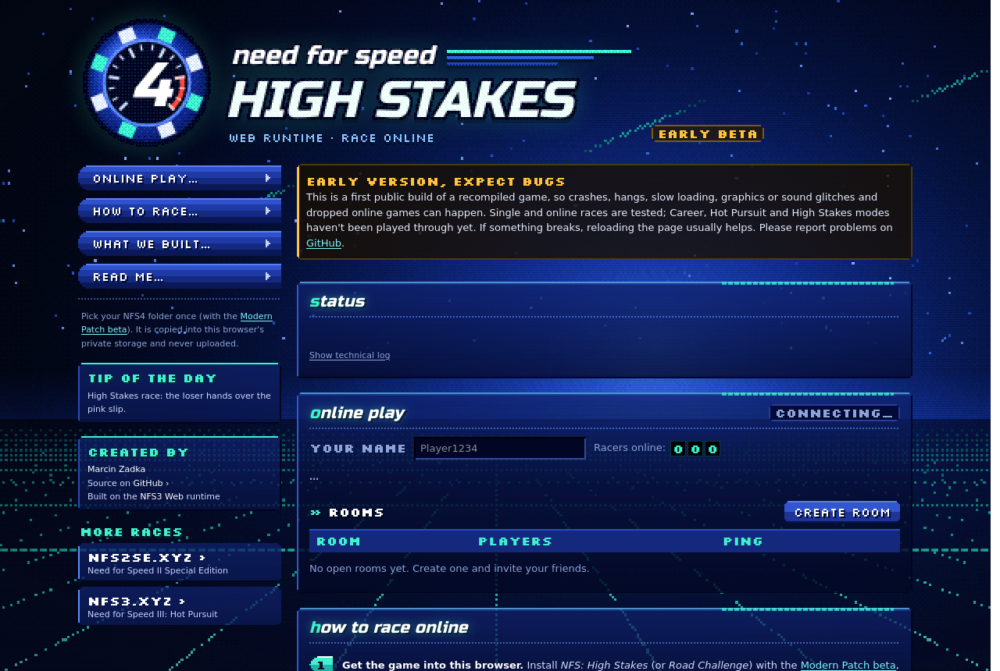
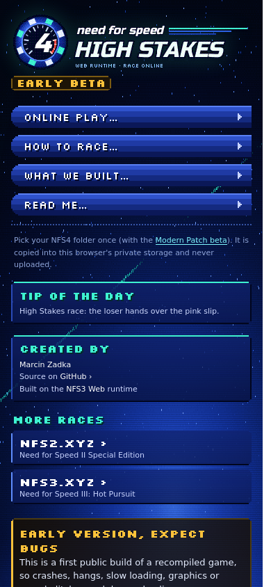

<div align="center">

# NFS4 Web

**Need for Speed: High Stakes (PC, 1999), recompiled to run in your browser, with online multiplayer.**

**▶ Play at [nfs4.xyz](https://nfs4.xyz)**. Bring your own copy of the game, pick its folder once, race your friends.




</div>

---

> [!WARNING]
> **Early beta, expect bugs.** This is the first public build. Crashes, hangs, slow loading,
> graphics or sound glitches and dropped online games can happen. Single and online races are
> tested; Career, Hot Pursuit and High Stakes modes haven't been played through yet. Please report
> what breaks in [Issues](https://github.com/mrz944/nfs4-web/issues).

## What is this?

NFS4 Web takes the original 1999 PC game, with VEG's **[NFS4 Modern Patch](https://veg.by/en/projects/nfs4/)**
(based on 4.50), and turns it into something a browser can run. It doesn't emulate a PC and it
isn't a remake. It **statically recompiles** the game's own x86 code into C and then WebAssembly,
so it runs the real game logic, physics, AI and netcode. Windows, DirectX, the Voodoo2 (Glide 3)
graphics card and the network stack are replaced by a small runtime written for the web.

It's the same approach as [NFS3 Web](https://github.com/mrz944/nfs3-web); most of the runtime
(lifter, Glide → WebGL 2 renderer, lobby and relay) is shared.

- 🏎️ **The real game.** The original code runs, recompiled, not reimplemented or re-tuned.
- 🎮 **Voodoo2 on your GPU.** The game's Glide 3 path is drawn with WebGL 2, in sharp 4:3 modes up to 2880x2160.
- 🌐 **Online in the browser.** Up to 8 racers per room, direct browser-to-browser links (WebRTC)
  with a relay fallback, a room browser, passwords and invite links.
- 🔒 **Your copy stays yours.** The site hosts no game files. You pick your NFS4 folder once; it's
  copied into the browser's private storage (OPFS) and never uploaded.

## The original game, and what we added

| Untouched: the real NFS4 | Added by this project |
|---|---|
| **Handling, physics and damage.** Every car drives exactly like on a 1999 PC. | **Static recompilation.** x86 code, MMX included, translated to C and WebAssembly. No PC emulator. |
| **Cars, tracks, AI and police.** The original game data, opponents and Hot Pursuit, including driving the cop car. | **Voodoo2 on your GPU.** The 3dfx Glide graphics path redrawn with WebGL 2, keeping the Voodoo fog, depth and blending. |
| **Music and sound.** The original soundtrack and effects through the game's own sound engine (`eacsnd.dll`). | **Single-core scheduling.** NFS4 expects one CPU core; its threads take turns by priority, as on Windows 98. |
| **Menus and modes.** Career, Single Race, Hot Pursuit, High Stakes, Knockout, Tournament, Showcase. | **Internet multiplayer.** The game's LAN (IPX) mode over the internet: rooms, WebRTC links, relay fallback, best-host pick. |

## Play it

1. Install *NFS: High Stakes* (or *Road Challenge* in Europe) for PC: `DATA` and `SAVEDATA` from the
   CD, then the [Modern Patch beta](https://veg.by/files/nfs4/) on top.
2. Open **[nfs4.xyz](https://nfs4.xyz)** in Chrome, Edge, Firefox or Safari (WebGL 2 needed).
3. Click **Choose NFS4 Folder…** and pick that folder (about 530 MB, copied once).
4. Click **Start Game**. For online races, make a room, share the invite link, and in the game pick
   **Connect Players → Network (IPX)**. The page has a step-by-step guide.

The page sets what the browser build needs in each copy of `nfs4.ini` (`ThrashDriver=glide3x`,
`NoMovies=1`, `SingleProcAffinity=1`) and writes your lobby name into the game.

## What's new compared with NFS3 Web

| | |
|---|---|
| **Lifter** | NFS4 uses instructions NFS3 didn't: MMX (movie decoder, blitters), `cmov`, `fcomi`, `ffree`, `fsincos`, `enter`. |
| **Win32** | ~50 more imports (`runtime/win32_extra.c`): drives and CD probing, child processes, version info, mixer and CD audio, `WritePrivateProfileString`, and the MSVC CRT start-up of the patched `voodoo2a.dll`. `LoadLibrary("DDRAW.DLL")` etc. now hand out the runtime's own system DLLs. |
| **Single-core mode** | NFS4 is not safe on a multi-core CPU. That's why the modern patch has `SingleProcAffinity=1`. Its file streamer, for example, checks a chunk before locking it (abort: *"STREAM_release - chunk has already been released"*), and busy-waits for its reader thread without calling the OS. The runtime emulates one core: only one guest thread runs at a time. It is handed over at blocking API calls, by thread priority as on Windows, with a 4 ms time slice among equals. The lifter puts a preemption check (one flag test) on every loop back-edge so that busy-waits hand over too. `RT_MULTICORE=1` turns it off. |
| **File lookups** | Case-insensitive paths with cached folder listings: in the browser each folder read costs ~30 ms, and the front end probes hundreds of files that don't exist. |
| **Online** | NFS4's IPX mode runs on the same virtual LAN. NFS4 adds a choice that NFS3 didn't have: **Positional Updates** vs **Controller Updates** (see below). |
| **Page** | Lo-fi pixel styling after NFS4's own front end, with its own emblem. The lobby name is written into `data/TEXT/TEXT.ENG` (default name) and `savedata/config.dat` (offset `0xF2C`). |

## Online play: how NFS4 does it

Connect Players offers *EA Racing Online* (EA's NPS lobby service, long shut down), *Network (IPX)*,
*Network (TCP)*, *Modem* and *Serial*. The browser build uses **IPX**, exactly as NFS3 Web does:
a room on the server looks like a LAN to the game. Every player gets a virtual IPX node, game
discovery is the game's own SAP broadcast on socket `0x452`, and packets go browser to browser
over WebRTC with a relay fallback.

When hosting, NFS4 asks:

- **Peer-to-Peer** or **Client/Server**: the topology, as in NFS3.
- **Controller Updates**: NFS3-style lockstep. Every machine simulates all cars from the
  inputs, the host's input counts at once, and clients wait one round trip to the host.
- **Positional Updates**: each machine drives its own car and sends its position. Your own
  car reacts instantly whoever hosts, which makes it the better choice over the internet.

Race traffic: Controller Updates send 32 small packets/s each way, as in NFS3. Positional Updates
send about 8 position packets/s (~240 bytes) and each game simulates its own car. Tested natively with
`RT_NET_DELAY=75` on both sides (150 ms round trip): a two-player race runs with matching clocks and no drops.

**Verified natively** (`tools/nettest.sh`, two headless instances through the relay): the game
list shows the host's game, the client joins, both show up in the multiplayer lobby with live
delay bars, and a two-player race on Celtic Ruins runs on both with synchronised clocks and
shared AI, with 0 drops.

## Graphics modes

NFS4 lists only exact 4:3 modes (`nfs4.exe` 0x51a4a5 checks `w * 3 == h * 4`) and renders in 4:3, so
real 16:9 would need a field-of-view rework of the game. Instead the driver's 16 mode records
(rewritten when `voodoo2a.dll` loads, `glide_patch_driver`) carry sharp 4:3 modes up to
**2880x2160**; the page pillarboxes them. With a Voodoo driver the game fixes its video memory
budget at 8 MB (only modes up to 1600x1200 fit); the runtime raises it to the renderer's 32 MB.
The page passes the screen size (`RT_SCREEN`), so only modes that fit the screen are offered.
Pick one in **Options → Graphics → Screen Size**: the menus stay 640x480, races use the chosen
mode. Tested natively: a race at 1792x1344 runs at the game's 64 fps cap.

Also from NFS3 Web: full frame rate on Windows (timers woken from the audio thread instead of
1 ms sleeps that Windows browsers round up to 15.6 ms), and Exit Game returns to the start page.

## Status

- 🌐 Public at **[nfs4.xyz](https://nfs4.xyz)** via a Cloudflare Tunnel (page, lobby, relay). No game files are hosted. See [docs/cloudflare.md](docs/cloudflare.md).
- ✅ Front end, intro movie, car showcase (3D), single race with 7 AI cars, keyboard and mouse
- ✅ Online: IPX discovery, host/join, multiplayer lobby, two-player race (verified natively)
- ✅ Smooth menus in the browser: priority scheduling and cached folder listings
- 🚧 Early beta: Hot Pursuit, High Stakes and Career modes not yet played through; sound only checked natively
- 🚧 No 16:9 yet (4:3, pillarboxed)

## Screenshots

| Start page | On a phone |
|---|---|
|  |  |

## Build it yourself

You need a copy of **NFS: High Stakes** (or *Road Challenge*) for PC plus the modern patch.

```sh
python3 -m venv .venv && .venv/bin/pip install capstone pefile

# game folder: DATA and SAVEDATA from the CD, then the modern patch on top
mkdir game && cp -r /cd/DATA game/data && cp -r /cd/SAVEDATA game/savedata
7z x nfs4_modern_patch_beta.7z -ogame -y          # https://veg.by/files/nfs4/
# merge the patch's data/menus into the CD's data/MENUS (same files, different case)

./build.sh game        # lift nfs4.exe, eacsnd.dll, voodoo2a.dll + native Linux build
./build-web.sh game    # browser build → web/dist/nfs4.{js,wasm}
node web/serve.mjs 8084 --game game
```

A CloneCD image (`.img`) can be turned into an ISO with `tools/img2iso.py in.img out.iso`.
How it all fits together: [ARCHITECTURE.md](ARCHITECTURE.md). Public hosting: [docs/cloudflare.md](docs/cloudflare.md).

### Native test helpers

| | |
|---|---|
| `tools/race.sh DIR SECS` | headless single race by mouse clicks (start-up smoke test) |
| `tools/nettest.sh SOCK SECS "IN_A" "IN_B"` | two instances in one relay room (`node web/serve.mjs 8095 --relay-tcp build/relay.sock`) |
| `RT_CURSOR_ADDR=689510` | scripted `CLICK@x;y` move from the game's real cursor (NFS4 moves it to the focused button itself) |
| `RT_INPUT=…,MEMDUMP` | dump the exe's data/bss to `build/mem_<t>.bin` (reverse-engineering aid) |
| `RT_MULTICORE=1` | turn off single-core mode |
| `RT_NO_DIRCACHE=1` | turn off the folder-listing cache |
| `RT_GUARD=1` | fault on guest accesses past 512 MB, like the browser (natively they silently read zeros) |
| `RT_NET_DELAY=ms` · `RT_FPS_LOG=1` · `RT_TICK_MS=15.6` | simulated latency · fps log · Windows-like coarse timers |

Everything from NFS3 Web still applies (`RT_HEADLESS`, `RT_DUMP`, `RT_TRACE`, `RT_NET*`, `RT_PROF`, `./re`).

## More races in your browser

| | |
|---|---|
| **[nfs2se.xyz](https://nfs2se.xyz/)** | Need for Speed II Special Edition |
| **[nfs3.xyz](https://nfs3.xyz/)** | Need for Speed III: Hot Pursuit ([source](https://github.com/mrz944/nfs3-web)) |
| **[nfs4.xyz](https://nfs4.xyz/)** | Need for Speed: High Stakes (this repo) |

## Credits

- [NFS3 Web](https://github.com/mrz944/nfs3-web) by Marcin Zadka: the runtime, lifter, renderer, lobby and relay this is built on.
- [NFS4 Modern Patch](https://veg.by/en/projects/nfs4/) by VEG (Evgeny Vrublevsky).
- [Capstone](https://www.capstone-engine.org/) and [Emscripten](https://emscripten.org/).
- Site fonts: [Russo One](https://fonts.google.com/specimen/Russo+One) and [Silkscreen](https://fonts.google.com/specimen/Silkscreen) (SIL OFL, `web/fonts/`).

*Need for Speed* and *High Stakes* are trademarks of Electronic Arts. This is an unofficial fan
project, not affiliated with or endorsed by EA. Game files, generated C and the wasm build are
never committed (see `.gitignore`).
